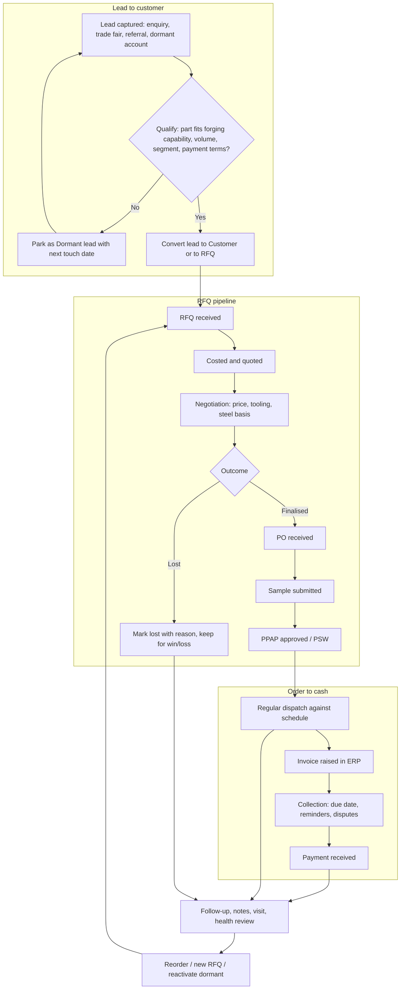

# Varsha CRM - product vision and process flow

Date: 28 Oct 2026, 19:00 IST. Status: vision for the owner's review. Documents only; no code is changed by this file.
Reads with: `CLAUDE.md` (rules), `docs/Phase2Design_19OCT2026_0446.md` (architecture, data model), `docs/ExpertReview_19OCT2026_0510.md` (health score, KPIs, operating rhythm).

Modules marked **built** exist in `js/` today (Dashboard, Customers, Leads, RFQs, Schedule, Export, revenue, money, report). Modules marked **planned** (Today, Accounts 360, Forecast, Automation, Sheet sync, Search) are specified here so builders and the owner share one picture; check the README tab list for what has landed.

## 1. Vision

One screen-set that answers, every morning, three questions for a forging supplier selling to auto OEMs and Tier-1/2 customers:

1. **Whom do I call today, and what did I promise?** (follow-ups, RFQ next actions, visits)
2. **Which quotes and new parts are moving or stuck?** (RFQ to PPAP)
3. **Who owes me money, and which customers are going quiet?** (collections, order recency, health)

The model is borrowed from Zoho CRM and Salesforce (lead, account, opportunity, activity, task, forecast, automation) but trimmed for a small B2B forging business where an "opportunity" is an **RFQ for a part**, an "account" is a **customer with plants**, and the long tail of the relationship is **regular dispatch against schedules**, not a one-off close.

Principles (from CLAUDE.md): the Google Sheets stay the books; the CRM is the memory and the nag. Status is set by hand. Overdue is red **and** in words. Nothing private is committed. Every action survives a refresh.

## 2. End-to-end lifecycle

Where each box lives in the CRM:

| Step | Where | Who writes it | Date rule |
|---|---|---|---|
| Lead, qualify, convert | Leads tab | Sales | Follow-up date; overdue red + "Overdue by N days" |
| Received to PPAP | RFQs tab (board + table); each stage change is logged with a date | Sales; sample/PPAP dates from NPD/quality | Quote and next-action dates; overdue quote is red |
| Dispatch | Schedule tab (typed orders) + dispatch history imported from the sheet | Dispatch/accounts via sheet | Imported dates are day-first |
| Invoice, collection | Imported from the sheet (INVOICE_REGISTER, Collections) | Accounts, in the sheet | "Data through <last invoice date>" always shown |
| Follow-up | Customers tab: Mark done, notes, call log, next date | Sales | Stored `YYYY-MM-DD`, "today" is Asia/Kolkata |

## 3. Roles and who does what

| Role | Does | Owns in the CRM | Looks at |
|---|---|---|---|
| **Owner / MD** | Sets targets, reviews weekly and monthly, decides on price and big RFQs | Targets; final say on Active / Follow up / At risk | Dashboard, weekly review, Accounts 360 for top accounts, Forecast |
| **Sales / key-account manager** | Daily calls and visits, qualifies leads, runs RFQs, negotiates | Follow-ups, notes, call log, leads, RFQs, visits | Today tab, Customers, Leads, RFQs |
| **Costing / engineering** | Quotes, feasibility, tooling and sample plan | RFQ quote values and dates | RFQs board (Received, Quoted) |
| **Quality / NPD** | Samples, PPAP/PSW, complaints | Sample and PPAP stage dates | RFQs board (Sample, PPAP) |
| **Dispatch / planning** | Schedules, dispatch, delivery | Dispatch rows in the sheet; typed upcoming orders | Schedule tab |
| **Accounts** | Invoices, collections, disputes | Invoice and Collections sheets (source of truth) | Customer money lines; overdue list |

In stage A one person may wear all hats; the table is the split to adopt when login arrives in stage B (account owner / backup owner fields, Phase 2 section 11).

## 4. Daily, weekly and monthly routine

### Daily: "My day" (Today tab), 5 to 15 minutes
1. Open **Today**. One list, ordered by urgency: overdue follow-ups (red, "Overdue by N days"), due today (orange), RFQ next actions due, overdue quotes, visits and calls today, tasks, orders due to dispatch.
2. Do the call or visit. **Log it the same day** with Mark done, and set the next follow-up date or explicitly "none".
3. Move any RFQ whose stage changed (quote sent, PO, sample, PPAP). The dated stage log drives turnaround and ageing.
4. In stage B the Telegram 11:00 IST reminder is the safety net for what is still open.

### Weekly sales review (Monday, 60 minutes, from the Dashboard; printable one-page report)
Numbers vs target and last year; collections (top overdue, 90+); RFQ pipeline (new, quotes due, ageing, wins and losses with reasons); released parts (PO, sample, PPAP); accounts with Weak health or status mismatch; next week's visits; actions logged in the CRM with owner and date. Agenda detail: Expert Review section 7.2.

### Monthly review (first working day; Print / PDF)
Billing vs budget and last year by segment; top-10 and concentration trend; funnel conversion and quote turnaround; new parts reaching SOP; collections aging; dormant customers and reactivation; health-score movers; target reset. Detail: Expert Review section 7.3. Quarterly: key-account plans and price-negotiation preparation.

## 5. Module map

Each paragraph: purpose, then the rule that powers it.

**Dashboard (built).** The read-only home. Every number is a button that opens the matching tab with the matching filter, and the row count equals the number. Rule: it only reads each module's `stats()` contract; percentages are 0-100; red and orange are used only for overdue and due-today meaning.

**Customers (built).** The master list of buying companies with contact, phone, plants, group, segment, vehicle segment, last order, follow-up date and hand-set status, plus notes and call log, Mark done and Edit. Rule: status (Active / Follow up / At risk) is set by hand only; a follow-up before today (India time) is red and reads "Overdue by N days".

**Leads (built).** Prospects and dormant accounts, in buckets, with follow-up and touch log, convertible to a customer or an RFQ. Rule: a lead's log rows carry `leadId` and `customerId ""`; conversion keeps the history and never invents contact data.

**RFQs (built).** The opportunity pipeline for parts: Received, Quoted, Negotiated, Finalised, PO, Sample, PPAP, with a lost marker. Rule: seven fixed stages in order, every change logged with a date; "released parts" are RFQs at Finalised or later; overdue quote and next-action dates are red.

**Schedule (built).** Visits and calls on a calendar, typed upcoming orders, and dispatch history by customer, part and month. Rule: dates stored `YYYY-MM-DD`; a missed visit or late order is red with words; dispatch history is re-imported from the sheet, not exported.

**Today / tasks (planned).** The "My day" cockpit: one ordered list of everything due, plus lightweight tasks (text, owner, due date, linked customer, RFQ or lead) that can be added from any row. Rule: ranking is deterministic (overdue by most days first, then due today, then upcoming), never a hidden score; tasks persist in `localStorage` as a collection registered through `Store.col`.

**Accounts 360 and health score (planned).** One drawer per customer: contacts, plants, open RFQs, last orders, outstanding and overdue, last contact, recent notes, and an advisory health badge. Rule (Expert Review section 5): score = points earned / weights available across order recency (25), overdue money (20), last contact (15), open complaints (15), OTIF (15), RFQ activity (10); bands 75-100 Healthy, 50-74 Watch, 0-49 Weak; fewer than 3 signals shows "Not enough data". The score never sets the status; a mismatch only shows a "Check status" chip.

**Forecast (planned).** Expected billing and pipeline view: open RFQs by stage with optional weighting, and typed upcoming orders by month against the target. Rule: weights are visible, editable assumptions (for example PO stage above Quoted), amounts come from imported data, the page always states "data through <date>", and a forecast never changes any record.

**Automation rules (planned).** Simple "when X then Y" helpers in the style of Zoho workflows, but local and visible: when an RFQ moves to Quoted, suggest a follow-up 7 days out; when an RFQ sits in one stage past N days, flag it; when a customer has had no contact for N days, add it to Today. Rule: a rule may suggest or flag, never silently edit status or amounts (CLAUDE.md rule 6); each rule shows its trigger, condition and effect in plain words and can be switched off.

**Sync from Google Sheets (planned).** One place to refresh money, invoices, orders and dispatch from the sheet. Stage A: download the tab as CSV and import (the page never writes to the sheet). Stage B: a scheduled server job reads the sheet read-only. Rule: header-name matching with a clear mismatch error, strict day-first date and number parsing, unmatched customers listed for manual matching, and "data through <last invoice date>" shown, because INVOICE_REGISTER data currently ends 12-Jul-2026.

**Export (built).** CSV, "Copy for Google Sheets", `customers.json`, private backup and restore, weekly review, and a list of what this browser holds with clear buttons. Rule: "Include notes", "Include contact details" and "Include amounts" are never remembered and default off; without a tick no export has note text, lead/RFQ emails, phones or contact references; money, invoices and dispatch are not exported.

**Search, Ctrl+K (planned).** A global finder for customers, leads, RFQs, parts and notes, opened from anywhere. Rule: it searches only data already in this browser, builds results with `textContent`, and shows note text only when the notes opt-in is ticked for that session.

## 6. Data ownership

| Data | Source of truth | CRM role |
|---|---|---|
| Invoices, taxable revenue, outstanding, overdue, aging | **Google Sheets** (INVOICE_REGISTER, Collections) | Read-only copy, imported, "Data through <date>", never written back, never exported or committed |
| Dispatch history, delivered quantities | **Google Sheets** | Imported copy |
| Customer master fields (name, plants, group, segment) | CRM (`customers.json` seed plus edits) | Owns; exported to `customers.json` |
| Follow-up dates, status, notes, call log | **CRM** | Owns; notes in the private backup only |
| RFQs and stage history, leads, visits, typed orders, tasks, targets | **CRM** | Owns; private backup only |

Rule of thumb: if accounts would correct it in the sheet, it is the sheet's. If sales would lose it when the browser is cleared, it is the CRM's, so back it up. Amounts, emails, lead phones, notes and GST numbers are never committed.

## 7. Stage plan

**Stage A (now): the HTML prototype.** Browser storage only, hosted statically, the owner reviews. No Supabase calls, no login, no keys, no real amounts in git. Plan B: any static server, or export the JSON if storage is blocked.

**Stage B (only after the owner's GO on stage A):**
- **Supabase** (Postgres with row-level security) behind the same `Store` API, so the UI does not change.
- **Login** with an allowlist of named users; account owner and backup owner on customers.
- **Telegram reminder at 11:00 IST** daily: overdue and due-today follow-ups per owner, driven by the same Today rules.
- **Scheduled sheet sync**: a read-only server job refreshes invoices and collections, so "data through" stays current without manual CSVs.
- Per-user change history (who changed what) once there is a shared database.

**Later (kept open by the data shapes, not committed to):** multiple contacts with roles; parts master; RFQ probability, SOP date, win/loss reason and competitors; complaints and 8D; OTIF computed from schedules; visit minutes with action items; price and steel-variation calendar; group registry; required-field rules.

## 8. KPI list

| KPI | Definition | Source | Notes |
|---|---|---|---|
| **Overdue follow-ups %** | Customers and leads with a follow-up before today, divided by those with any follow-up date, x 100 | Customers, Leads | `overduePct` is 0-100; red above threshold, with words |
| **RFQ conversion** | RFQs reaching Finalised or later divided by RFQs closed (Finalised+ or Lost), by quarter | RFQ stage log | Show the count as well as the %; lost needs a reason |
| **Quote turnaround** | Days from Received to Quoted, median and share over target | RFQ stage dates | Stage dates are recorded from day one |
| **OTIF (placeholder)** | On-time-in-full deliveries over total, last 3 months | Schedule / orders import | Placeholder until a delivery-versus-schedule feed exists; shows "No data", not a number |
| **Concentration** | Share of taxable revenue from the top 1 and top 5 customers (related parties shown separately) | Revenue import | Red when one customer exceeds the agreed share; "data through" date shown |
| Support KPIs | Billing vs target and last year; outstanding and 90+ share; average health score; dormant count; pipeline by stage | Imports, RFQs, health score | Money shown only when amounts are switched on |

## 9. Open questions for the owner

1. Which concentration share should turn red (for example 25 percent for one customer)?
2. Quote turnaround target in days?
3. Should "Released parts" begin at Finalised or at PO?
4. Who is account owner for each key customer once login exists?
